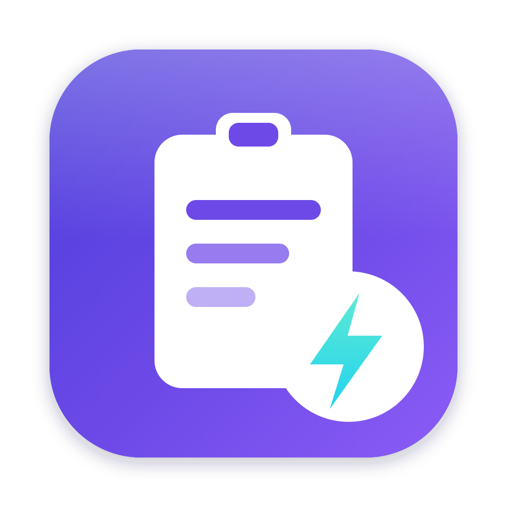

<div align="center">



# MacCV

**A fast, faithful macOS clipboard.**

A menu-bar clipboard manager with a Rust engine and a SwiftUI front end. It reads
and writes the *native* pasteboard — not just text — so copy and paste keep every
byte the original app put there.

[](https://github.com/yxxbc/Maccv/actions/workflows/ci.yml)
[](https://github.com/yxxbc/Maccv/releases)
[](LICENSE)
[](#requirements)
[](https://www.rust-lang.org)

</div>

---

## Why MacCV

Most clipboard managers flatten everything to a string. Copy a table from Numbers
and you get tab-separated text. Copy from Figma and you get a bitmap. Copy a
styled paragraph and you lose the styling.

MacCV doesn't do that. It captures the pasteboard the way AppKit stores it — every
type, every item — and puts it back the same way. Paste a rich paragraph into
Pages and it arrives formatted. Paste an image and it arrives as the original PNG,
not a re-encode.

That fidelity needs speed to be usable, so the engine is written in Rust and linked
as a static library. There is no IPC, no serialization step, and no subprocess.

## Measured behaviour

Numbers below are from `maccv-core`'s test suite on an Apple-silicon Mac, and are
asserted by the tests rather than measured once by hand.

| Operation | Cost | Note |
|---|---|---|
| Detect a change (`changeCount`) | **0.53 µs** | Cheap enough to poll, so no event tap and no Accessibility permission |
| Read plain text | **9.9 µs** | Includes the `NSString` bridge |
| Write text | **215 µs** | AppKit's own cost: the OS notifies every interested process |
| Notice an external `pbcopy` | **116 µs** | From a 400 µs poll interval |
| Release app bundle | **808 KB** | Whole app, engine included |

## What it handles

Every pasteboard type macOS defines, not a text-only subset:

| Category | Types |
|---|---|
| Text | `public.utf8-plain-text`, `public.utf8-tab-separated-values-text` |
| Rich text | `public.rtf`, `com.apple.flat-rtfd`, `public.html` |
| Images | `public.png`, `public.tiff`, `com.adobe.pdf` |
| Files | `public.file-url` (multi-file copies stay multi-file) |
| Links | `public.url` |
| Colour | `com.apple.cocoa.pasteboard.color` (resolved to sRGB) |
| Sound | `com.apple.cocoa.pasteboard.sound` |
| Fonts & rulers | `com.apple.cocoa.pasteboard.font`, `…ruler` |
| Anything else | Custom UTIs are preserved and replayed verbatim |

A single copy can carry several of these at once — a paragraph from Safari arrives
as plain text, RTF *and* HTML — and MacCV keeps all of them, so it can paste into
whatever the target app wants.

## Requirements

- macOS 27 or later
- For building: Xcode 27, Rust 1.85+, [XcodeGen](https://github.com/yonaskolb/XcodeGen)

## Build and run

```bash
git clone https://github.com/yxxbc/Maccv.git
cd Maccv

# Rust engine: build and test it on its own
cargo test
cargo build --release -p maccv-ffi

# The app (generates MacCV.xcodeproj, then builds it)
cd apps/mac
xcodegen generate
xcodebuild -scheme MacCV -configuration Release build
```

The Xcode project is generated from `apps/mac/project.yml`. That file is the source
of truth — edit it rather than the `.xcodeproj`, which is not committed.

A pre-build phase compiles the Rust engine and links it in, so an Xcode build is
the only step you need.

### Verifying the install

Every layer can check itself:

```bash
cargo test                                  # Rust: 37 tests, incl. live pasteboard round trips
cargo clippy --workspace --all-targets      # lints
xcodebuild -scheme MacCV build              # Swift ↔ C ABI ↔ Rust
```

The compiled app also self-tests the full stack:

```bash
"$BUILD_DIR/MacCV.app/Contents/MacOS/MacCV" --self-test
```

## Project layout

```
crates/maccv-core/       Rust clipboard engine (the interesting part)
crates/maccv-ffi/        C ABI bridge; also generates include/maccv.h
apps/mac/                SwiftUI app; project.yml is the project source of truth
Scripts/build-rust.sh    Builds + lipos the engine, called by Xcode and CI
assets/                  Logo and social preview (SVG + rendered PNG)
```

### How the two halves connect

`maccv-core` is plain Rust with no C anything, so it can be used and tested
directly. `maccv-ffi` is a thin `staticlib` that exposes it over a C ABI;
`cbindgen` generates `maccv.h` from that surface during the build. Swift imports
the header through a bridging header and calls straight into Rust — the same
address space, no marshalling layer.

Two decisions worth knowing about:

**The watcher opens its own handle.** `objc2` deliberately does not mark `NSObject`
subclasses as `Send`. Rather than force that with an `unsafe impl`, the watcher
thread reopens the pasteboard by name and passes only the change counter across the
thread boundary.

**Snapshots are copied once, and owned.** The C ABI hands back one allocation
containing an item array, representation arrays, payload bytes and strings. Freeing
the snapshot frees all of it, and nothing points into Rust memory that has already
been dropped.

## macOS 27 and pasteboard privacy

macOS 27 polices programmatic access to the general pasteboard. The first time an
app reads it, the system may ask the user, and the answer can be remembered as
"never allow" — which is permanent.

MacCV treats that as a first-class state rather than an error to retry:

- The engine reports `AccessDenied`, and the panel shows what happened and why.
- The current policy is readable through `Pasteboard::access_behavior`.
- Nothing polls in a tight loop trying to get around a refusal.

The app is not sandboxed, and no data leaves the machine. History is in-memory
only; persistence is on the roadmap.

## Roadmap

- [x] Full-type pasteboard read/write, lossless round trips
- [x] Change watching with adaptive polling
- [x] Multi-item (*n* files, *n* items) fidelity
- [x] SwiftUI menu-bar panel
- [ ] On-disk history (SQLite) surviving relaunch
- [ ] Global hotkey
- [ ] Drag and drop into and out of the panel
- [ ] Pinned entries, per-app rules, sensitive-content filtering

## Contributing

Issues and pull requests are welcome — see [CONTRIBUTING.md](CONTRIBUTING.md) and
the [Code of Conduct](CODE_OF_CONDUCT.md).

If you are changing the engine, the tests in `crates/maccv-core/tests/clipboard.rs`
run against a real `NSPasteboard` (a private one, so your clipboard is untouched).
They are the best description of the intended behaviour.

## License

[Apache-2.0](LICENSE) © yxxbc

## Acknowledgements

Built on [`objc2`](https://github.com/madsmtm/objc2) for safe Objective-C
interop, which is what makes a Rust AppKit engine pleasant rather than hazardous.
