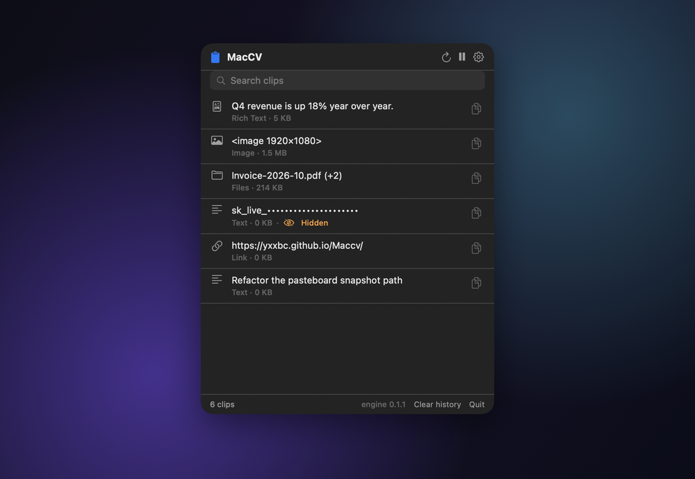

<div align="center">


# MacCV

**Copy anything. Find it again. Paste it back exactly as it was.**

A menu-bar clipboard manager for macOS that keeps every format a copy carried — not
just the text — and can hand it to an app without the clipboard ever seeing it.

<br>

[](https://github.com/yxxbc/Maccv/releases/latest)
&nbsp;
[](https://yxxbc.github.io/Maccv/)
&nbsp;
[](README.zh-CN.md)

<br>

[](https://github.com/yxxbc/Maccv/actions/workflows/ci.yml)
[](https://github.com/yxxbc/Maccv/releases)
[](https://github.com/yxxbc/Maccv/releases)
[](LICENSE)
[](#requirements)
[](#download)
[](https://www.rust-lang.org)
[](#light)

</div>

<br>

<div align="center">
  
</div>

<br>

## What it does

**Keeps every format.** Copy a table from Numbers and most managers give you
tab-separated text. MacCV keeps the rich text, the HTML *and* the plain text, so it
pastes correctly into whatever app you are in. Copy three files from Finder and you
get three files back, not three lines of text.

**Pastes without the clipboard.** Enable it, and MacCV types the content straight
into the frontmost app as keystrokes. It never enters the shared clipboard, so no
other application can read what you pasted. See [Security](#security) for why this
is the only thing that actually delivers that.

**Hides what it should.** Card numbers, API keys, tokens and ID numbers are detected
and masked when the entry is *stored*, not just when it is drawn. Entries a password
manager marked as concealed are never recorded at all.

**Stays out of the way.** It notices a copy in about half a microsecond, so it does
not need to watch your keystrokes — which means **no Accessibility permission just to
run**. It sits in the menu bar and costs nothing while idle.

**Talks to you in your language.** English and 简体中文, following your system.

<br>

## Download

| Your Mac | | |
|---|---|---|
| **Apple silicon** (M1, M2, M3, M4…) | [Download arm64](https://github.com/yxxbc/Maccv/releases/latest) | |
| **Intel** | [Download x86_64](https://github.com/yxxbc/Maccv/releases/latest) | |

Open the DMG and drag **MacCV** onto **Applications**. Not sure which you have?
→  About This Mac. If it says *Chip: Apple M…* take the Apple silicon build.

Every release publishes a `SHA256SUMS` file, and the app verifies the digest and the
code signature before it will install an update.

Windows and Linux are not planned. This is a native macOS app, using AppKit's
pasteboard directly — porting it would mean writing it again.

<br>

## Requirements

- **macOS 15 or later** (Sequoia), Apple silicon or Intel
- Nothing else. No helper, no daemon, no account

<br>

## Security

Most clipboard managers are vague here. Here is the accurate version.

> **Once content is on the system pasteboard, any application on your Mac can read
> it.** That is not a bug or a missing feature — it is how macOS is designed. There
> is no API to write to the pasteboard privately. The `ConcealedType` marker that
> password managers set is a voluntary convention, and macOS's own access control
> decides only whether *this* app may read, never whether anyone else may.

So MacCV does the one thing that actually works: **Paste Without Clipboard** sends
your text to the frontmost app as synthetic keystrokes. The content never enters a
shared channel, so no other process *can* observe it. That is a guarantee, not a
policy.

It has real costs, which is why it is off by default:

| | |
|---|---|
| **Needs Accessibility access** | Injecting input into another app is exactly what that permission gates |
| **Slower** | Delivered at typing pace, not instantly |
| **Text only** | An image has no keystroke form, so images use the clipboard path |

What MacCV does guarantee:

- **Nothing leaves your Mac.** There is no telemetry, no analytics, no crash
  reporting, and no account. The only network requests are update checks.
- **Your history is never written to disk**, so other apps cannot read it.
- **No AI ever reads your data.** There is no model, local or remote.

And what it does **not** claim: it cannot stop another app reading the clipboard.
Nothing can. This is written down plainly because a privacy claim you cannot verify
is worse than no claim at all.

**Full detail:** [Security standards](docs/SECURITY.md) ·
[How updates are verified](docs/SECURITY.md#s3-update-integrity)

<br>

## Light

An idle clipboard manager should be invisible.

<div align="center">

| | | | |
|---|---|---|---|
| **0.53 µs** | **9.9 µs** | **1.9 MB** | **0 bytes** |
| to notice a copy | to read text | app bundle | written to disk while idle |

</div>

It checks the clipboard ~2000× a second right after a copy, then backs off to four
times a second when nothing is happening. No timer runs in the UI. Every number here
is asserted by a test, so it cannot quietly stop being true —
see [performance standards](docs/PERFORMANCE.md).

<br>

## Build it yourself

Requires Xcode 27, Rust 1.85+ and [XcodeGen](https://github.com/yonaskolb/XcodeGen).

```bash
git clone https://github.com/yxxbc/Maccv.git
cd Maccv

Scripts/verify.sh          # every check, 16 stages
cd apps/mac && xcodegen generate && open MacCV.xcodeproj
```

`apps/mac/project.yml` is the source of truth for the Xcode project; the
`.xcodeproj` is generated and not committed. A build phase compiles the Rust engine
and links it in.

<br>

## Project layout

| | |
|---|---|
| `crates/maccv-core/` | The engine. Clipboard, redaction, secure input, updates. |
| `crates/maccv-ffi/` | C ABI bridge. Generates `include/maccv.h`. |
| `apps/mac/` | SwiftUI app. `project.yml` is the source of truth. |
| `docs/` | [Website](docs/) plus the [standards](docs/SECURITY.md). |
| `Scripts/` | Build, verify, package, release. |

The engine is plain Rust, testable on its own. The app links it as a **static
library**, so there is no IPC, no serialization step, and no helper process — the
reason a pasteboard read is microseconds rather than milliseconds.

<br>

## Documentation

| | |
|---|---|
| [Security](docs/SECURITY.md) | What is guaranteed, what macOS makes impossible, plugin model |
| [Performance](docs/PERFORMANCE.md) | Budgets, how each number is measured, regression policy |
| [Testing](docs/TESTING.md) | What is tested, and what is not |
| [Releasing](docs/RELEASING.md) | Channels, the release procedure, emergency revocation |
| [Contributing](CONTRIBUTING.md) | Setup, conventions, the house rules |
| [Changelog](CHANGELOG.md) | What changed, per version |

<br>

## Roadmap

- [x] Every pasteboard format, lossless
- [x] Menu-bar panel with search
- [x] Paste without the clipboard
- [x] Sensitive-content masking
- [x] Signed, verified, self-updating releases
- [x] English and 简体中文
- [x] macOS 15, universal binary
- [ ] Global hotkey with a centred panel
- [ ] Drag content in and out
- [ ] On-disk history that survives relaunch
- [ ] Notarization, so the first launch is silent

<br>

## Contributing

Issues and pull requests are welcome. Read [CONTRIBUTING.md](CONTRIBUTING.md) first —
it covers the conventions and the two rules that matter most: tests run against a
private pasteboard so your clipboard is never touched, and a privacy claim needs a
check behind it.

<br>

## License

[Apache-2.0](LICENSE) © 2026 yxxbc

Built on [`objc2`](https://github.com/madsmtm/objc2), which is what makes a Rust
AppKit engine pleasant rather than hazardous.

</div>
