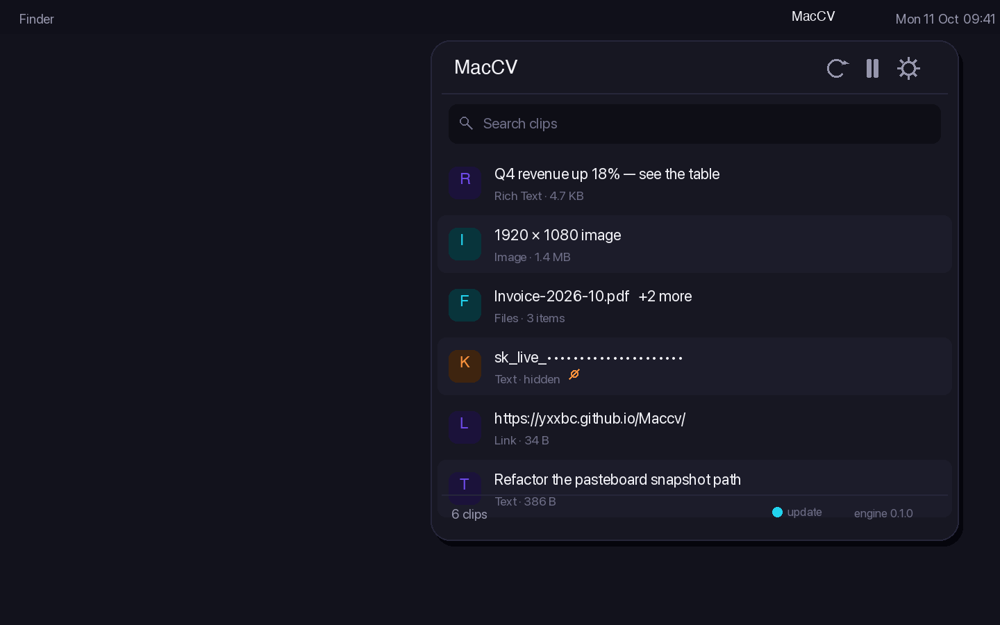

<div align="center">


# MacCV

**复制任何东西，随时找回，原样粘贴。**

macOS 菜单栏剪贴板管理器。它保留一次复制携带的**每一种格式** —— 而不只是文本 ——
并且可以在剪贴板完全看不到内容的情况下把它送进应用。

<br>

[](https://github.com/yxxbc/Maccv/releases/latest)
&nbsp;
[](https://yxxbc.github.io/Maccv/zh/)
&nbsp;
[](README.md)

<br>

[](https://github.com/yxxbc/Maccv/actions/workflows/ci.yml)
[](https://github.com/yxxbc/Maccv/releases)
[](LICENSE)
[](#环境要求)
[](#下载)
[](https://www.rust-lang.org)
[](#轻)

</div>

<br>

<!--
  预览占位

  这里应该放一段录屏：复制一段富文本、打开面板、粘贴回原格式。控制在 4 MB 以内，
  存为 assets/preview.gif，然后把下面这段替换成：

    <div align="center">
      
    </div>

  静帧无法替代「面板打开、内容落进另一个应用」这个过程的演示。
-->

<div align="center">
  
  <br>
  <sub><i>预览制作中 —— 菜单栏面板、实时预览与搜索。</i></sub>
</div>

<br>

## 它能做什么

**保留每一种格式。** 从 Numbers 复制一个表格，多数管理器只给你制表符分隔的文本。
MacCV 会同时保留富文本、HTML **和**纯文本，因此无论你在哪个应用里都能正确粘贴。
从访达复制三个文件，拿回来的就是三个文件，而不是三行文本。

**不经过剪贴板粘贴。** 开启后，MacCV 会把内容以按键形式直接输入到最前面的应用。
内容从不进入共享剪贴板，因此**其他应用无法读取你粘贴的内容**。
为什么只有这种方式能真正兑现这一点，见[安全性](#安全性)。

**该隐藏的会隐藏。** 卡号、API 密钥、令牌、证件号会被识别并打码 ——
而且是在条目**存储时**打码，不只是显示时。密码管理器标记为隐藏的条目根本不会被记录。

**不打扰你。** 它感知一次复制只需约 0.53 微秒，因此不需要监听你的按键 ——
也就是说，**仅仅为了运行它，不需要辅助功能权限**。它待在菜单栏里，闲置时零开销。

**说你的语言。** English 与简体中文，跟随系统。

<br>

## 下载

| 你的 Mac | | |
|---|---|---|
| **Apple 芯片**（M1、M2、M3、M4…） | [下载 arm64](https://github.com/yxxbc/Maccv/releases/latest) | |
| **Intel** | [下载 x86_64](https://github.com/yxxbc/Maccv/releases/latest) | |

打开 DMG，把 **MacCV** 拖到**应用程序**里即可。不确定自己是哪种？
→  关于本机。写着 *芯片：Apple M…* 就用 Apple 芯片版。

每个版本都会发布 `SHA256SUMS` 文件；应用在安装更新前会校验摘要与代码签名。

不打算支持 Windows 与 Linux。这是一个直接使用 AppKit 剪贴板接口的原生 macOS 应用，
移植等于重写。

<br>

## 环境要求

- **macOS 15 或更高版本**（Sequoia），Apple 芯片或 Intel
- 别无其他。没有辅助进程、没有守护进程、不需要账号

<br>

## 安全性

多数剪贴板管理器在这件事上含糊其辞。以下是准确的版本。

> **内容一旦进入系统剪贴板，Mac 上任何应用都能读取。** 这不是缺陷，也不是缺失的功能 ——
> 这是 macOS 的设计。没有任何 API 可以把内容写进剪贴板而不被他人读取。
> 密码管理器设置的 `ConcealedType` 标记只是靠自愿遵守的约定；
> 而 macOS 自身的访问控制只决定**这个应用**能不能读，从来管不着别人。

所以 MacCV 做那件真正有效的事：**不经过剪贴板粘贴**会把文本以合成按键直接送到最前面的应用。
内容全程不进入任何共享通道，因此其他进程**在物理上无法**观察到它。这是保证，不是承诺。

它也有真实代价，所以默认关闭：

| | |
|---|---|
| **需要辅助功能权限** | 向其他应用注入输入正是该权限所管辖的能力 |
| **更慢** | 按打字速度投递，不是瞬间完成 |
| **仅限文本** | 图片没有按键表示，仍走剪贴板路径 |

MacCV 确实保证的：

- **数据不离开你的 Mac。** 没有遥测、没有统计、没有崩溃上报、不需要账号。
  唯一的网络请求是检查更新。
- **历史记录从不写入磁盘**，因此其他应用读不到它。
- **AI 永不读取你的数据。** 没有本地模型，也没有远程模型。

以及它**不**声称的：它无法阻止其他应用读取剪贴板。没有东西能做到。
把这点写明，是因为**一个你无法验证的隐私声明，比没有声明更糟**。

**完整细节：**[安全标准](docs/SECURITY.md) · [更新如何校验](docs/SECURITY.md#s3-update-integrity)

<br>

## 轻

闲置的剪贴板管理器应该是不存在的。

<div align="center">

| | | | |
|---|---|---|---|
| **0.53 µs** | **9.9 µs** | **1.9 MB** | **0 字节** |
| 感知一次复制 | 读取文本 | 应用包体 | 闲置时写入磁盘 |

</div>

复制发生后它以约每秒 2000 次的频率检查剪贴板，没有变化时退避到每秒 4 次。
UI 层没有任何定时器。这里的每个数字都由测试断言，因此不会悄悄失效 ——
见[性能标准](docs/PERFORMANCE.md)。

<br>

## 自行构建

需要 Xcode 27、Rust 1.85+ 与 [XcodeGen](https://github.com/yonaskolb/XcodeGen)。

```bash
git clone https://github.com/yxxbc/Maccv.git
cd Maccv

Scripts/verify.sh          # 全部检查，16 个阶段
cd apps/mac && xcodegen generate && open MacCV.xcodeproj
```

`apps/mac/project.yml` 是 Xcode 工程的唯一事实来源；`.xcodeproj` 是生成产物，不纳入版本控制。
构建阶段会编译并链接 Rust 引擎。

<br>

## 项目结构

| | |
|---|---|
| `crates/maccv-core/` | 引擎：剪贴板、打码、安全输入、更新 |
| `crates/maccv-ffi/` | C ABI 桥接层，生成 `include/maccv.h` |
| `apps/mac/` | SwiftUI 应用，`project.yml` 是事实来源 |
| `docs/` | [官网](docs/) 与[各项标准](docs/SECURITY.md) |
| `Scripts/` | 构建、验证、打包、发布 |

引擎是纯 Rust，可独立测试。应用以**静态库**方式链入它，因此没有 IPC、没有序列化、
没有辅助进程 —— 这正是剪贴板读取以微秒而非毫秒计的原因。

<br>

## 文档

| | |
|---|---|
| [安全性](docs/SECURITY.md) | 保证什么、macOS 使其不可能的部分、插件模型 |
| [性能](docs/PERFORMANCE.md) | 预算、每个数字如何测量、回归处理 |
| [测试](docs/TESTING.md) | 测了什么，以及没测什么 |
| [发布](docs/RELEASING.md) | 渠道、发布流程、紧急撤回 |
| [参与贡献](CONTRIBUTING.md) | 环境搭建、约定、项目规则 |
| [更新日志](CHANGELOG.md) | 逐版本变更 |

<br>

## 路线图

- [x] 全部剪贴板格式，无损
- [x] 带搜索的菜单栏面板
- [x] 不经过剪贴板粘贴
- [x] 敏感内容打码
- [x] 签名校验的自动更新
- [x] English 与简体中文
- [x] macOS 15、通用二进制
- [ ] 全局快捷键与居中面板
- [ ] 内容的拖入与拖出
- [ ] 重启后保留的磁盘历史
- [ ] 代码公证，首次打开不再提示

<br>

## 参与贡献

欢迎提交 issue 与 pull request。请先读 [CONTRIBUTING.md](CONTRIBUTING.md) ——
其中包含约定，以及最重要的两条规则：测试使用私有剪贴板，绝不会碰你的剪贴板；
每一个隐私声明背后都必须有相应的检查。

<br>

## 许可证

[Apache-2.0](LICENSE) © 2026 yxxbc

构建于 [`objc2`](https://github.com/madsmtm/objc2) 之上 ——
正是它让用 Rust 写 AppKit 引擎变得舒适而非危险。

</div>
