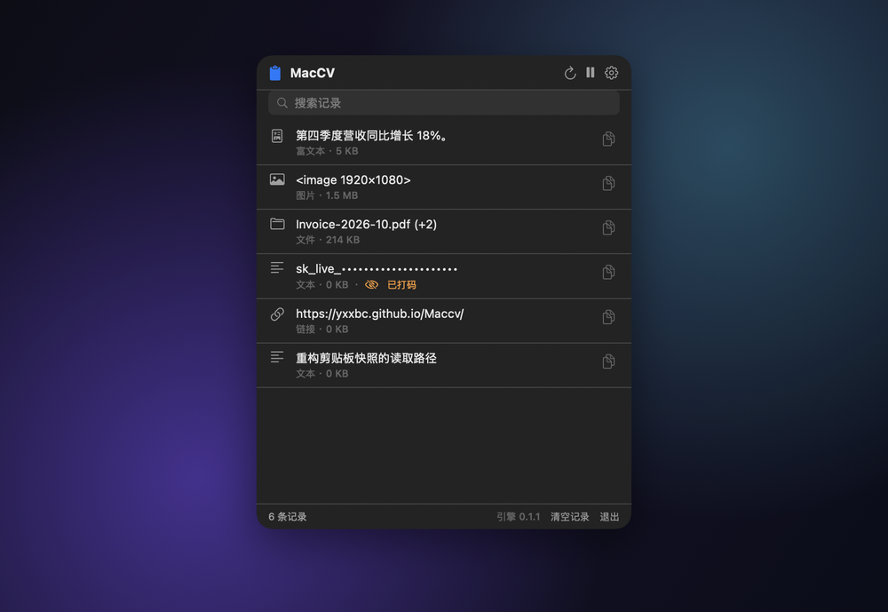

<div align="center">


# MacCV

**永远不会把你的密码放上剪贴板的剪贴板管理器。**

面向 macOS 的菜单栏剪贴板管理器。它保留一次复制携带的**每一种格式** —— 而不只是文本 ——
并且可以把内容以按键形式送进应用，**因此 Mac 上其他程序读不到你粘贴了什么**。

<br>

[](https://github.com/yxxbc/Maccv/releases/latest)
&nbsp;
[](https://yxxbc.github.io/Maccv/zh/)
&nbsp;
[](README.md)

<br>

[](https://github.com/yxxbc/Maccv/actions/workflows/ci.yml)
[](https://github.com/yxxbc/Maccv/releases)
[](https://github.com/yxxbc/Maccv/releases)
[](LICENSE)
[](#环境要求)
[](#安装)
[](#它是怎么构建的)
[](#轻)

</div>

<br>

<div align="center">
  
</div>

<br>

## 别的剪贴板管理器做不到的那件事

所有剪贴板管理器都要写系统剪贴板，而**系统剪贴板是全局可读的**。这不是这些应用的能力问题，
而是 macOS 的设计。没有任何 API 可以私下写入：

- `NSPasteboardContentsOptionsCurrentHostOnly` 阻止的是同步到你的其他设备，不是其他应用。
- AppKit 里根本没有 `concealed` 标志。`org.nspasteboard.ConcealedType` 只是应用自愿遵守的约定，
  没有任何东西强制它。
- `NSPasteboardAccessBehavior` 决定的是**这个应用**能不能读，管不着别人。

所以 MacCV 干脆把剪贴板从这条路上移开。开启「**不经过剪贴板粘贴**」后，内容会以合成按键
直接输入到最前面的应用。它全程不进入任何共享通道，因此其他进程**在物理上无法**观察到它。

它默认关闭，因为代价是真实的，应该由你来权衡：

| | |
|---|---|
| **需要辅助功能权限** | 向其他应用注入输入正是该权限所管辖的能力 |
| **更慢** | 按打字速度投递，不是瞬间完成 |
| **仅限文本** | 图片没有按键表示，因此图片仍走剪贴板 |

这些，包括 MacCV **做不到**什么，都被如实写下来 —— 因为一个你无法验证的隐私声明，
比没有声明更糟。
→ [完整安全立场](docs/SECURITY.md)

MacCV 确实保证的：

- **数据不离开你的 Mac。** 没有遥测、没有统计、没有崩溃上报、不需要账号。
  唯一的网络请求是检查更新。
- **历史记录从不写入磁盘**，因此其他应用读不到它。
- **AI 永不读取你的数据。** 没有本地模型，也没有云端模型。

以及它**不**声称的：它无法阻止其他应用读取剪贴板。没有东西能做到。
把这点写在这里而不是埋起来，是因为**一个你无法验证的隐私声明，比没有声明更糟**。

## 它还做什么

**保留每一种格式。** 从 Numbers 复制一个表格，多数管理器只给你制表符分隔的文本。
MacCV 会同时保留富文本、HTML **和**纯文本 —— 因此无论你在哪个应用里都能正确粘贴。
从访达复制三个文件，拿回来的就是三个文件，而不是三行文本。

**该隐藏的会隐藏。** 卡号、API 密钥、JWT、私钥、带凭据的网址、邮箱、身份证号会被识别并打码，
而且是在条目**存储时**打码，不只是显示时。密码管理器标记为隐藏的条目根本不会被记录。

**不打扰你。** 它感知一次复制只需约 0.53 微秒，因此不需要监听你的按键 ——
也就意味着，**仅仅为了运行它，不需要辅助功能权限**。它待在菜单栏里，闲置时零开销。

**说你的语言。** English 与简体中文，跟随系统。

## 安装

下载对应你 Mac 的版本，打开 DMG，把 **MacCV** 拖到**应用程序**里。

| 你的 Mac | 下载 |
|---|---|
| **Apple 芯片**（M1–M4） | [MacCV-…-arm64.dmg](https://github.com/yxxbc/Maccv/releases/latest) |
| **Intel** | [MacCV-…-x86_64.dmg](https://github.com/yxxbc/Maccv/releases/latest) |

→  关于本机。写着 *芯片：Apple M…* 就用 Apple 芯片版。

**第一次打开时 macOS 会警告** —— 提示「Apple 无法验证 MacCV 是否包含恶意软件」。
这是 Gatekeeper 在说这个版本尚未公证，**不是在报告它里面有什么东西**。
清除隔离属性**不能**解决它 —— 判定依据是签名。右键 → **打开**一次即可，或到
「系统设置 → 隐私与安全性 → 仍要打开」。公证已列入[路线图](#路线图)。

每个版本都会发布 `SHA256SUMS`；应用在安装自身更新前会校验摘要与签名。

## 环境要求

- **macOS 15 或更高版本**（Sequoia），Apple 芯片或 Intel
- 别无其他。没有辅助进程、没有守护进程、不需要账号、没有遥测

不打算支持 Windows 与 Linux。这是一个直接驱动 AppKit 剪贴板接口的原生 macOS 应用，
移植等于重写。

## 轻

闲置的剪贴板管理器应该是不存在的。

<div align="center">

| | | | |
|---|---|---|---|
| **0.53 µs** | **9.9 µs** | **1.9 MB** | **0 字节** |
| 感知一次复制 | 读取文本 | 应用包体 | 闲置时写入磁盘 |

</div>

复制发生后它以约每秒 2000 次的频率检查剪贴板，没有变化时退避到每秒 4 次。
UI 层没有任何定时器。这里的每个数字都由测试断言，因此不会悄悄失效 →
[性能标准](docs/PERFORMANCE.md)。

## 它是怎么构建的

Rust 引擎以**静态库**方式链入 SwiftUI 应用，中间是一层 C ABI。没有 IPC、没有序列化步骤、
没有辅助进程 —— 这个决定让剪贴板读取以微秒而非毫秒计，其余大部分选择都是它的推论。

```
crates/maccv-core/     引擎：剪贴板、打码、合成输入、更新
crates/maccv-ffi/      轻薄的 C ABI；cbindgen 生成 include/maccv.h
apps/mac/              SwiftUI 应用；project.yml 是唯一事实来源
docs/                  官网，以及这个项目遵守的各项标准
Scripts/               构建、验证、打包、发布
```

如果你是冲着 Rust 来的：`maccv-core` 是纯 Rust，不含任何 C 相关的东西，可以独立测试；
`maccv-ffi` 只做翻译。值得一读的 AppKit 行为在 `crates/maccv-core/src/pasteboard.rs`，
而塑造它的两个约束是：`objc2` 不为 `NSObject` 子类实现 `Send`（所以监听线程自己重开句柄，
而不是把句柄跨线程搬过去），以及 `writeObjects:` 之前必须先 `prepareForNewContents`。

```bash
git clone https://github.com/yxxbc/Maccv.git && cd Maccv
Scripts/verify.sh                      # 26 个阶段，约 3 分钟 —— 与 CI 同一条命令
cargo test -p maccv-core --release     # 只跑引擎，带耗时输出
```

`apps/mac/project.yml` 是 Xcode 工程的唯一事实来源；`.xcodeproj` 是生成产物，不纳入版本控制。
构建阶段会编译引擎并链接进去。

## 文档

| | |
|---|---|
| [安全性](docs/SECURITY.md) | 保证什么、macOS 使其不可能的部分、插件模型 |
| [性能](docs/PERFORMANCE.md) | 预算、每个数字如何测量、回归处理 |
| [测试](docs/TESTING.md) | 测了什么 —— 以及刻意没测什么 |
| [发布](docs/RELEASING.md) | 渠道、发布流程、紧急撤回 |
| [参与贡献](CONTRIBUTING.md) | 环境搭建、约定、项目规则 |
| [更新日志](CHANGELOG.md) | 逐版本变更 |

## 路线图

- [x] 全部剪贴板格式，无损
- [x] 带搜索的菜单栏面板
- [x] 不经过剪贴板粘贴
- [x] 敏感内容打码
- [x] 按架构分发 DMG，带校验和与经过校验的更新器
- [x] English 与简体中文、macOS 15、通用二进制
- [ ] 全局快捷键与居中面板，接近系统剪贴板的体验
- [ ] 内容拖入拖出，并显示来源应用
- [ ] 重启后保留的磁盘历史
- [ ] 代码公证，首次打开不再提示

## 参与贡献

欢迎提交 issue 与 pull request —— 请见 [CONTRIBUTING.md](CONTRIBUTING.md)。其中最重要的两条规则：
测试使用**进程私有**剪贴板，绝不会碰你自己的剪贴板；每一个隐私声明背后必须有检查支撑，
而不是文档里的一句话。

## 许可证

[Apache-2.0](LICENSE) © 2026 yxxbc

构建于 [`objc2`](https://github.com/madsmtm/objc2) 之上 ——
正是它让用 Rust 写 AppKit 引擎变得舒适而非危险。
